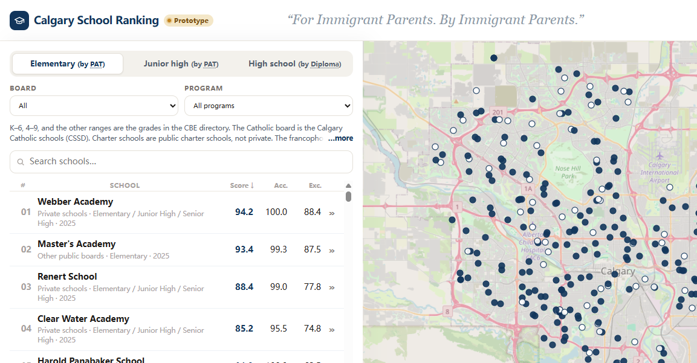

# Calgary school ranking

A prototype for immigrant and newcomer parents in Calgary. It ranks elementary and junior high schools on Alberta's Provincial Achievement Test (PAT), ranks high schools on the diploma exam, and shows each school's attendance area on a map.

The page covers Calgary. The header says Prototype until that changes. The code is [MIT licensed](LICENSE). Data from the City and the province keep their own licences, listed below.



## Open it

The public page is <https://school-maps-beta.vercel.app/>.

Vercel publishes the files in `web/`. `vercel.json` turns off install and build, and sets the output directory to `web`. A push to `main` updates the site. `school-maps.vercel.app` is a different site. `school-maps-xujun.vercel.app` and each long deployment address ask for a Vercel login.

`web/data/` is already in the repo, so a checkout runs with no download:

```bash
python3 -m http.server 8765 -d web
```

Then open http://localhost:8765/ . On Windows the same command is `python -m http.server 8765 -d web`.

The page opens in English. The menu also offers 简体中文, 繁體中文, Français, 日本語, and 한국어. `?lang=` accepts `en`, `zh`, `zh-Hant`, `fr`, `ja`, or `ko`.

To rebuild the data files, use Python 3.12 and the pins in `requirements.txt`. The pinned OCR package does not run on Python 3.13:

```bash
python3 -m venv .venv && .venv/bin/pip install -r requirements.txt
.venv/bin/python scripts/build_data.py
.venv/bin/python scripts/fetch_cbe_directory.py
.venv/bin/python scripts/fetch_ab_contacts.py
.venv/bin/python scripts/build_zones.py
```

Windows: `.venv\Scripts\python` and `.venv\Scripts\pip`.

## What the page does

- The list on the left is the ranking. The switch above the filters chooses elementary, junior high, or high school. The map on the right draws one point per school still in that list. `?level=junior` opens junior high, and `?level=high` opens high school.
- Filters are board, grade, and program. Each opens on All. The grade filter is hidden on the high-school list. Search matches the school name, board, and program. The table shortens Elementary, Junior High, and Senior High to Elem, Jr, and Sr. The school card keeps the full grade phrase.
- Click a row or a point to move the map and open the card: website, phone, address, board, grades, and score. The school name on the row is plain text. The website link is on the card.
- » on a row opens the communities in that CBE attendance zone, their 2026 assessed values, and 2021 census figures. A circled ! explains a figure.
- A school with no CBE zone, including Catholic, charter, and private schools, outlines the community its point falls in. The panel says that outline is the community, not an attendance zone.
- A missing website, phone, address, zone, or score is "no data".

Elementary uses the latest Grade 6 PAT. Junior high uses the latest Grade 9 PAT. High school uses the diploma exam. A school that teaches more than one level appears on each of those lists, with that level's score. A school with no published result for the level stays at the bottom and is not numbered.

Confirm a designated school with the [CBE School Finder](https://www.cbe.ab.ca/find-a-school). The page does not call CBE when you open it.

## How the score works

The rank uses one year, the newest year in the file:

**rank score** = (% acceptable + % excellence) / 2

Schools with no published result stay at the bottom and are not numbered. The table shows that score and the two rates, Acc and Exc. Click a column header to sort by that number. Click it again to reverse the order. When acceptable is tied, excellence breaks the tie in the same direction. When excellence is tied, acceptable does. A missing rate stays last.

The pipeline also stores a three-year average of those rates (2023, 2024, 2025 in the current file). That average is not the rank. The definitions table below separates the two.

## Engineering decisions

The browser only reads files in `web/`. Python joins the public sources first, so opening the page does not download spreadsheets or call a city API. There is no frontend framework and no build step.

Elementary is the Grade 6 PAT, junior high is the Grade 9 PAT, and high school is the diploma exam mark. Each list uses the newest year for that exam. The stored three-year average is not the rank. A school that teaches more than one level is on each list.

School names match through `normalize_name`, which drops filler words and rewrites `St.` and `&`. A name that still differs is left unmatched. The Assurance table is an image. OCR tokens within 16 pixels vertically count as one row. A blank cell stays blank.

`zones.geojson` is downloaded the first time a school is selected, not with the list. If that file fails, the map does not draw a community outline in its place. Other limits are listed below.

`index.html` sets `ASSET_VERSION`. Change that one string when `style.css`, the page scripts, or `web/data/` change.

## Built with AI, on cursor-prime

This app was written with AI in [Cursor](https://cursor.com), following [cursor-prime](https://github.com/xnoahwang/cursor-prime) v0.3.3.

cursor-prime is a coding standard for the agent, not a library the page loads. Before a non-trivial change it writes a plan and waits. After the change it runs a real check and reports what actually changed. Missing numbers stay missing. UI strings are added in all six languages together. Edits stay on the files the task named.

That is what produced this site: a Python pipeline that joins public data, a static page that only displays the result, and `scripts/verify.py` to catch a broken join. The rule text used in this repo is under `.cursor/rules/`. `AGENTS.md` is the map of the layout.

## Refresh school files

`scripts/update_schools.py` refreshes the CBE directory, Alberta phone and website file, and CBE zones. A file is replaced only when the new text differs. A failed or empty download keeps the file already on disk. Home values are not part of this refresh.

On Windows, this registers a weekly Sunday 09:00 run, including after a missed start once the machine is on:

```bash
.venv/bin/python scripts/update_schools.py --install-task
```

The log is `data/raw/logs/update_schools.log` and is not committed. `fetch_community_profiles.py` and `fetch_assurance.py` are separate. They are not part of that weekly run.

## Verify

```bash
.venv/bin/python -m pytest
.venv/bin/python scripts/verify.py
node --test web/rank.test.mjs
```

Install `requirements-dev.txt` once before `pytest`. `verify.py` reads `web/data/` and exits 0 when the checks pass. It does not download. `rank.test.mjs` checks who is ranked and how ties and missing scores sort. `.github/workflows/ci.yml` runs the same three commands on a push or pull request to `main`.

## How the numbers are made

| Field | Definition |
|---|---|
| Stored PAT % acceptable / % excellence | "% Acc of Enrol" and "% Exc of Enrol" from the Alberta PAT school multi-year file. Averaged over every regular course in the grade (Knowledge & Employability courses excluded) and over the latest **3 years with data (2023, 2024, 2025)**. Suppressed `n/a` cells are skipped and never counted as 0. This average is stored. It is not the rank. |
| Rank score | The same formula on the **newest year only**. Elementary uses the Grade 6 PAT (`g6_latest`). Junior high uses the Grade 9 PAT (`g9_latest`). High school uses the diploma exam mark (`diploma_latest`), not the school-awarded mark. `rank_score` is the PAT field and stays empty for a high school. |
| Home value | Median `assessed_value` of residential accounts with a building (class RE, property type LI) in the 2026 roll. Shown as no data when the community has fewer than 50 such accounts. The zone panel uses this figure. |
| Children 0–14 | 2021 census share of household population age 0–14 (`f9wk-wej9`). |
| Families with children | 2021 census: (married with children + common-law with children + one-parent families) / census families (`msjx-5ygv`). |
| Enrolment | Headcount from Open Calgary `9qye-mibh` for the newest school year in that file (2023–2024 as of this build). |

Any missing input is "no data", never zero. A real published 0.0 is kept as published.

## Data sources and licences

| Data | Source | Licence |
|---|---|---|
| Community boundaries (residential only) | [surr-xmvs Community District Boundaries](https://data.calgary.ca/d/surr-xmvs). The `ab7m-fwn6` map view returns empty features through the API, so its backing dataset is used. | [Open Government Licence – City of Calgary](https://data.calgary.ca/d/Open-Data-Terms/u45n-7awa) |
| Schools (location, board, grades) | [fd9t-tdn2 Schools](https://data.calgary.ca/d/fd9t-tdn2). `xmep-aasr` "Schools in Communities" is a map view whose API returns empty rows. | same |
| PAT results by school | [Alberta Education ed-pat-multiyear-sch-list.xlsx](https://www.alberta.ca/system/files/custom_downloaded_images/ed-pat-multiyear-sch-list.xlsx) | [Open Government Licence – Alberta](https://open.alberta.ca/licence) |
| Diploma exam results by school | [diploma-multiyear-sch-list-annual.xlsx](https://www.alberta.ca/system/files/custom_downloaded_images/diploma-multiyear-sch-list-annual.xlsx). Exam mark only. | OGL – Alberta |
| Home values | [4bsw-nn7w Current Year Property Assessments (Parcel)](https://data.calgary.ca/d/4bsw-nn7w). `p84b-7zbi` "Assessments by Community" only covers 2016–2017, so it is not used. | OGL – City of Calgary |
| 2021 census age | [f9wk-wej9 Population and Dwellings by Community](https://data.calgary.ca/d/f9wk-wej9) | OGL – City of Calgary |
| 2021 census families | [msjx-5ygv Families and Households by Community](https://data.calgary.ca/d/msjx-5ygv) | OGL – City of Calgary |
| Enrolment | [9qye-mibh School Enrolment Data](https://data.calgary.ca/d/9qye-mibh). Newest year in the file. | OGL – City of Calgary |
| CBE school directory | [cbe.ab.ca/school-directory](https://www.cbe.ab.ca/school-directory). Phone, address, website, grades, and programs. | CBE public pages |
| Alberta school contacts | [Schools and authorities](https://open.alberta.ca/opendata/alberta-education-schools-and-authorities). Phone and website only, and only when the school does not already have them. The file date is in `web/data/ab_contacts.json`. | OGL – Alberta |
| CBE attendance and walk zones | KMZ files loaded by the public [CBE School Finder](https://www.cbe.ab.ca/find-a-school). `scripts/build_zones.py` writes `web/data/zones.geojson`. | CBE public pages |
| Basemap | © [OpenStreetMap](https://www.openstreetmap.org/copyright) contributors (ODbL), standard tile server. For anything beyond prototype traffic, follow the OSM tile usage policy or self-host. | ODbL |

As-of dates for the Open Calgary, PAT, and diploma downloads are in `web/data/meta.json` (`sources.*.as_of`).

## Limitations

- PAT data covers grades 6 and 9 only. Schools that end before grade 6 (for example K–4) have no PAT score.
- PAT match: 372 of 423 elementary or junior-high schools in the City list (87.9%) are matched by board and normalised name. 299 of the 322 CBE/CSSD-named schools in the PAT file (92.9%) are matched. Most unmatched City schools are K–4/K–5 schools or private schools that do not appear in the PAT file. See `web/data/meta.json → stats`.
- Diploma result: 78 of 111 senior schools in the City list (70.3%) have a published diploma exam result for the newest year. The other 33 stay on the high-school list without a number. A school is in that group when its name did not match a row, or when the file publishes no exam rate. See `web/data/meta.json → stats`.
- Assessed value is not the market price, and the median mixes houses and condos.
- 2020 median household income and languages spoken most often at home come from the City's 2021 community-profile PDFs (`web/data/community_profiles.json`). They are not an Open Calgary table. The 2016 income table (`wj3a-wgmh`) is not used.
- The Assurance survey on a CBE card is the six survey rows from that school's School Improvement Results PDF. Except parental involvement, each percentage combines students, parents, and teachers. A suppressed cell, or a cell the reader cannot confirm, is "no data". A second read keeps a number only when that cell comes back as a clean percentage. The reports were not checked school by school by hand. It is not part of the exam score. CSSD and private schools are not in those reports.
- Test scores reflect demographics as much as teaching quality. They are one input for families.

## Layout

```
web/index.html          page shell
web/app.js              load data, translate, connect controls
web/rank.js             who is listed, which exam, sort order
web/zone.js             attendance zone and the zone panel
web/map.js              school points, polygons, zoom
web/i18n.js             UI strings in six languages
web/style.css           layout
web/data/               generated, committed so the site runs without a rebuild
scripts/build_data.py   community boundaries, schools, PAT, census, enrolment
scripts/build_zones.py  CBE attendance and walk zones
scripts/fetch_cbe_directory.py
scripts/fetch_ab_contacts.py
scripts/fetch_community_profiles.py
scripts/fetch_assurance.py
scripts/update_schools.py
scripts/store.py        write a generated file only when its text changed
scripts/verify.py       data checks
tests/                  name folding and Assurance row grouping
.github/workflows/ci.yml
data/raw/               download cache, gitignored, one directory per script
docs/preview.png        screenshot used above
```
